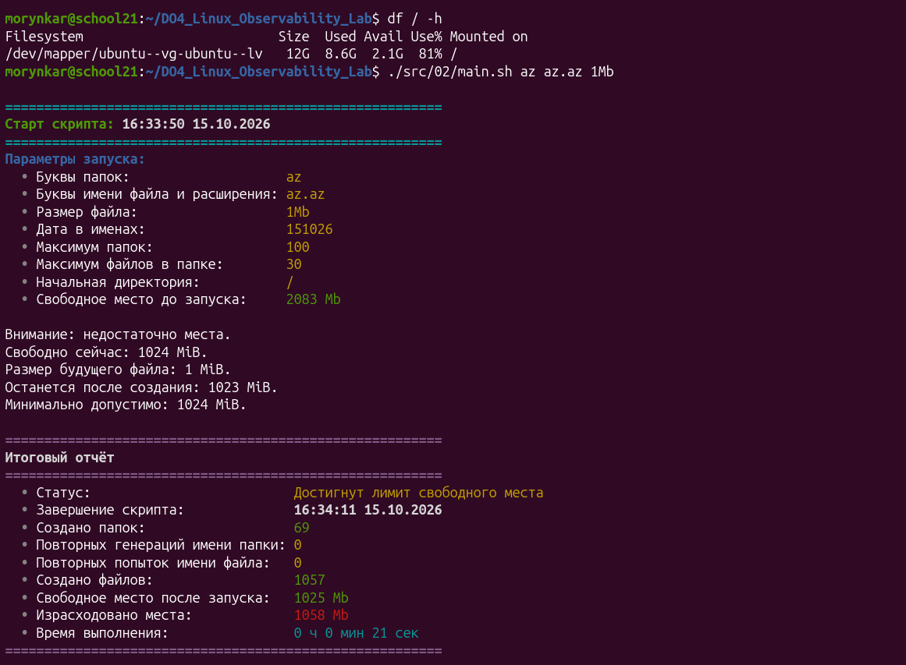
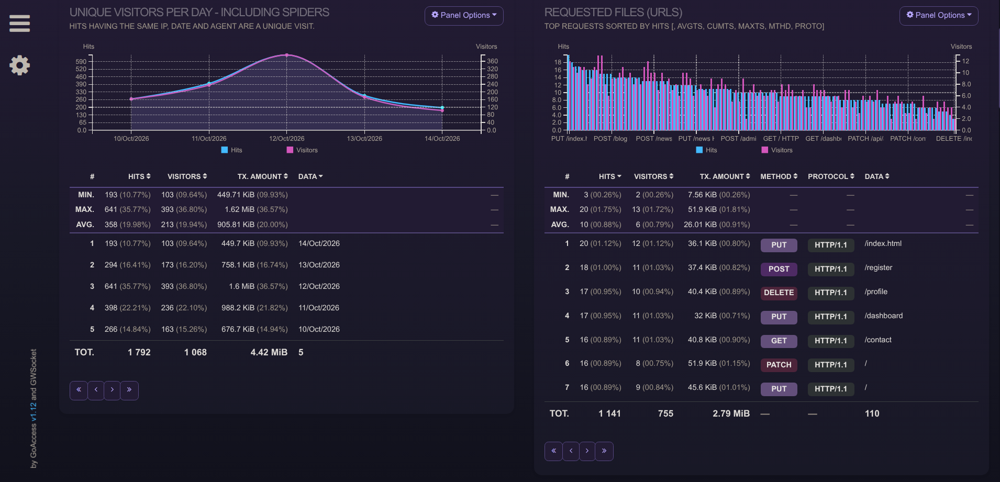
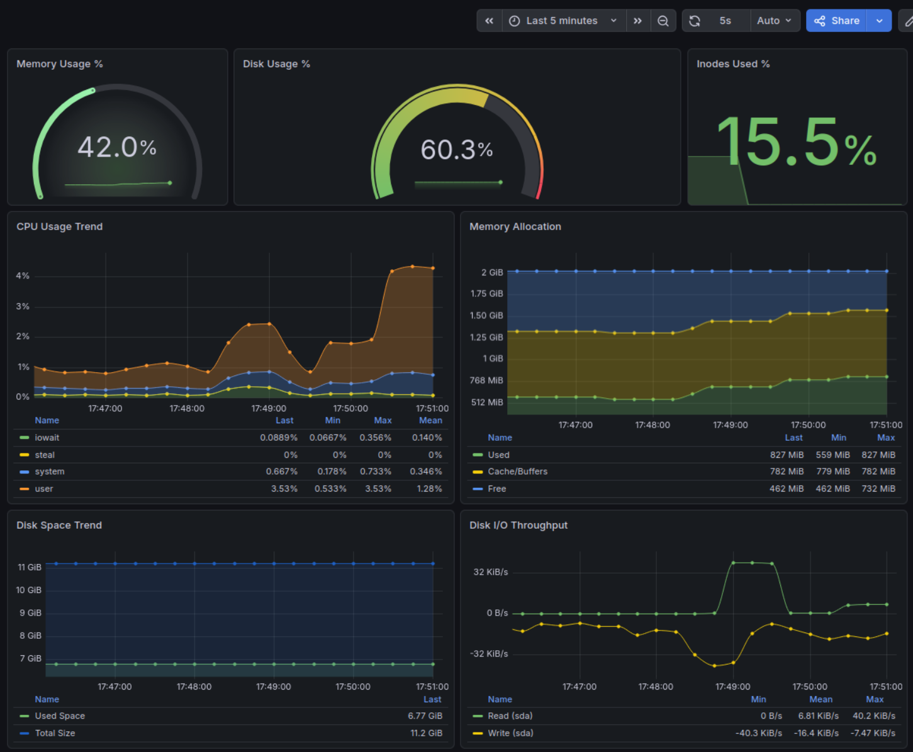
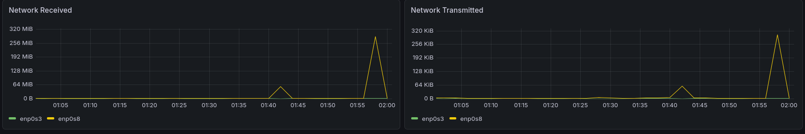
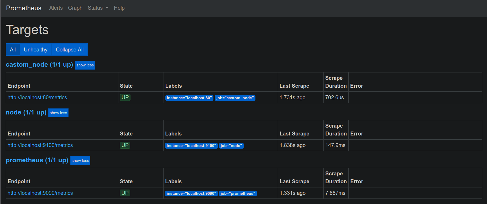

# DO4 — Linux Observability Lab

Лабораторный стенд для изучения жизненного цикла данных мониторинга: генерации файлов и HTTP-логов, анализа событий, сбора системных метрик и визуализации нагрузки в Prometheus, Grafana и GoAccess. Заключительная часть реализует собственный exporter в формате Prometheus.

## Навигация по проекту

Отчёт разделён по этапам проекта. **[Открыть оглавление и проверку соответствия ТЗ →](docs/walkthrough.md)**

| Часть | Что реализовано | Код и отчёт |
| --- | --- | --- |
| 1 | Генератор каталогов и файлов | [`src/01/`](src/01/) · [отчёт](docs/part1-part3.md#part-1-генератор-файлов) |
| 2 | Нагрузка на файловую систему | [`src/02/`](src/02/) · [отчёт](docs/part1-part3.md#part-2-нагрузка-на-файловую-систему) |
| 3 | Очистка по журналу, времени и маске | [`src/03/`](src/03/) · [отчёт](docs/part1-part3.md#part-3-очистка) |
| 4 | Генератор nginx access-логов | [`src/04/`](src/04/) · [отчёт](docs/part4-part6.md#part-4-генератор-http-логов) |
| 5 | Анализ логов с `awk` | [`src/05/`](src/05/) · [отчёт](docs/part4-part6.md#part-5-анализ-логов) |
| 6 | Терминальный и HTML-отчёты GoAccess | [`src/06/`](src/06/) · [отчёт](docs/part4-part6.md#part-6-анализ-логов-в-goaccess) |
| 7 | Prometheus, Node Exporter и Grafana | [`src/07/`](src/07/) · [подробный отчёт](docs/part7-prometheus-grafana.md) |
| 8 | Готовый dashboard и `iperf3` | [`src/08/`](src/08/) · [подробный отчёт](docs/part8-node-exporter-dashboard.md) |
| 9 | Собственный exporter | [`src/09/`](src/09/) · [подробный отчёт](docs/part9-custom-exporter.md) |

Дополнительно: [архитектура и потоки данных](docs/architecture.md) · [проверка соответствия исходному заданию](docs/walkthrough.md#соответствие-исходному-заданию).

## Возможности

- генерация файловых деревьев и журналирование созданных объектов;
- очистка сгенерированных данных по журналу, времени или маске;
- создание nginx access-логов в Combined Log Format;
- фильтрация логов по HTTP-коду, IP и ошибочным запросам;
- интерактивные и HTML-отчёты GoAccess;
- сбор метрик через Prometheus и Node Exporter;
- пользовательские и готовые Grafana dashboards;
- наблюдение дисковой, вычислительной и сетевой нагрузки;
- выдача собственных метрик через nginx.

## Структура

```text
src/01–03/  генерация и очистка файлов
src/04–06/  генерация и анализ HTTP-логов, GoAccess
src/07–08/  Prometheus, Grafana, Node Exporter и нагрузочные тесты
src/09/     собственный exporter
docs/       отчёты, архитектура и скриншоты
```

## Требования

Проект рассчитан на Ubuntu Server и использует Bash, GNU Coreutils, `awk`, `sed`, `bc`, nginx, GoAccess, Prometheus, Grafana, Node Exporter, `stress` и `iperf3`. Некоторые сценарии устанавливают пакеты и управляют службами через `sudo`.

## Безопасность запуска

Parts 1–3 создают или удаляют файлы, а Parts 6–9 могут изменять пакеты и systemd-службы. Их следует запускать только в отдельной виртуальной машине после изучения параметров и исходного кода. Сценарии сохраняют логику выполненной лабораторной работы; область записи и удаления в Parts 1–3 дополнительно не ограничена.

Безопасно просмотреть справку и проверить синтаксис можно так:

```bash
./src/04/main.sh --help
./src/06/main.sh help
bash -n src/{01..09}/*.sh
```

## Ключевые результаты

Проект охватывает полный путь от генерации тестовых данных до их анализа и визуализации:

| Файловая нагрузка, Parts 1–3 | Анализ логов, Parts 4–6 |
| --- | --- |
|  |  |

| Мониторинг, Part 7 | Сетевая нагрузка, Part 8 | Собственный exporter, Part 9 |
| --- | --- | --- |
|  |  |  |

## Ограничения

Сценарии ориентированы на учебную VM и не предназначены для запуска на рабочем сервере без дополнительной изоляции. Конфигурации используют локальные targets и требуют адаптации имён дисков, интерфейсов и адресов под конкретный стенд.

Работа проверялась на Ubuntu Server 24.04 LTS. В исходном учебном окружении указана Ubuntu Server 20.04 LTS; версия системы отличается, но используемые Bash-сценарии и утилиты сохранили требуемое поведение.
