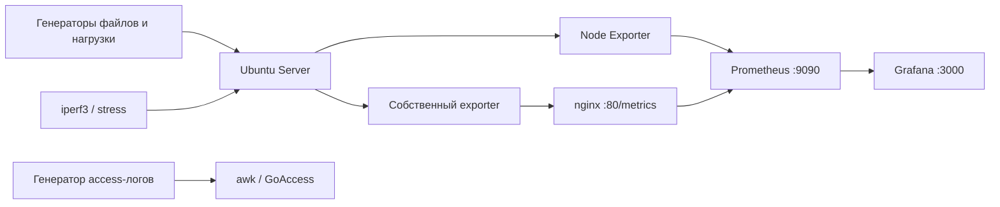

# Архитектура мониторинга

[← README](../README.md) · [Оглавление отчёта](walkthrough.md)

## Потоки данных

Parts 1–3 создают контролируемую файловую нагрузку и затем удаляют её результаты.

Parts 4–6 образуют отдельный поток наблюдаемости: генератор пишет access-логи, после чего `awk` и GoAccess формируют текстовые и HTML-представления.

В Parts 7–8 Node Exporter отдаёт системные метрики на порту `9100`, Prometheus собирает их и передаёт Grafana для визуализации. Нагрузку создают файловый генератор, `stress` и `iperf3`.

В Part 9 Bash-сценарий самостоятельно формирует метрики CPU, памяти, диска и файловой системы. nginx отдаёт их по пути `/metrics`, а отдельная Prometheus job опрашивает endpoint на порту `80`.

## Конфигурации

- [`src/07/configs/`](../src/07/configs/) — пользовательский Grafana dashboard и Prometheus;
- [`src/08/configs/`](../src/08/configs/) — готовый Node Exporter dashboard;
- [`src/09/configs/`](../src/09/configs/) — собственный dashboard, Prometheus и пример метрик.

Адреса `localhost` подходят для одновузлового стенда. При распределённом развёртывании targets необходимо заменить адресами соответствующих виртуальных машин.
