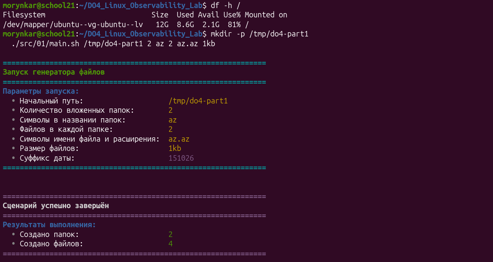
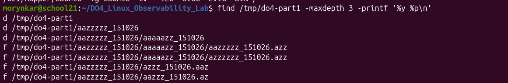
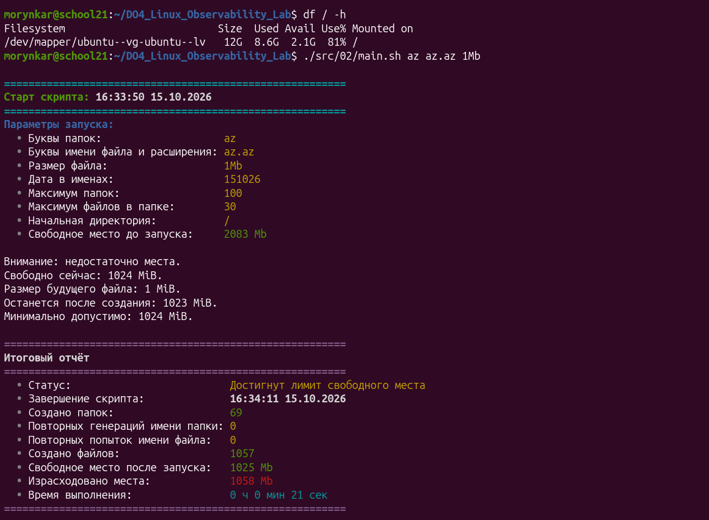
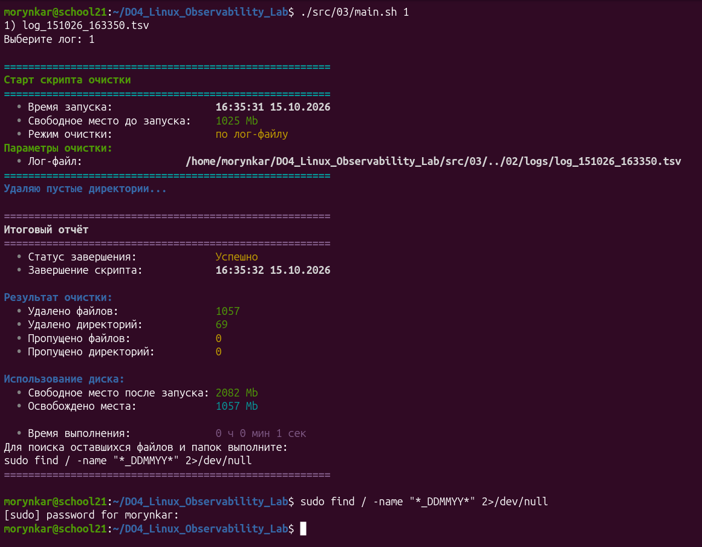
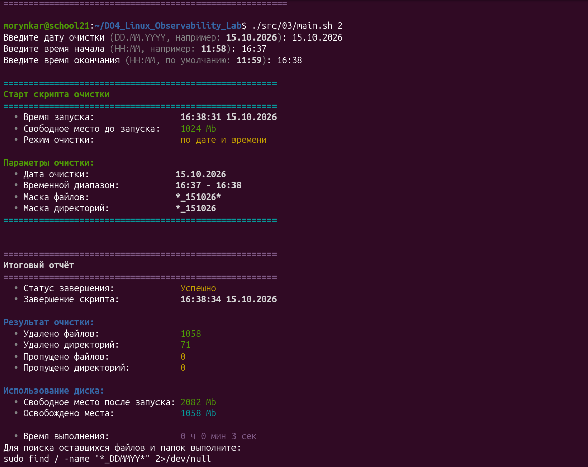
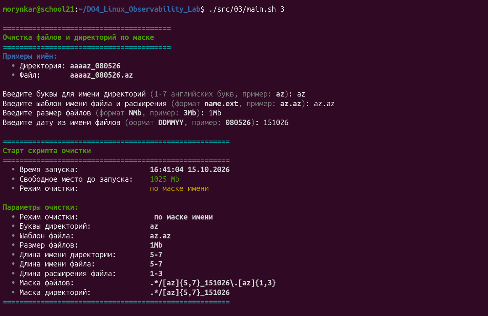
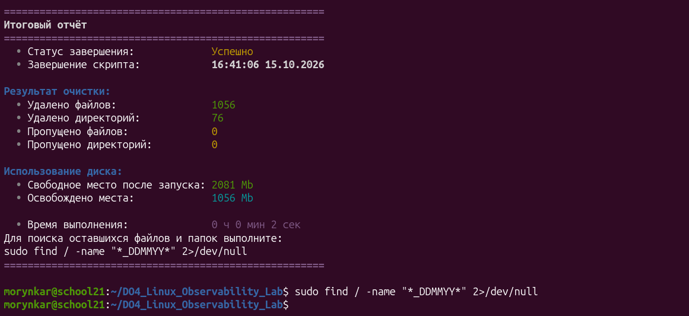

# Parts 1–3. Генерация файловой нагрузки и очистка

[← README](../README.md) · [Оглавление](walkthrough.md) · [Part 1](#part-1-генератор-файлов) · [Part 2](#part-2-нагрузка-на-файловую-систему) · [Part 3](#part-3-очистка) · [Parts 4–6 →](part4-part6.md)

> Parts 1–3 изменяют файловую систему. Parts 6–9 могут устанавливать пакеты и управлять службами. Все эксперименты выполняются только внутри изолированной виртуальной машины.

## Part 1. Генератор файлов

Сценарий создаёт заданное количество каталогов и файлов по маскам символов, добавляет дату к именам и записывает сведения о созданных объектах в TSV-журнал. Входные параметры проверяются до начала генерации, а итоговый отчёт показывает число созданных элементов и использованное место.

Исходный код: [`src/01/`](../src/01/).

```bash
mkdir -p /tmp/do4-part1
./src/01/main.sh /tmp/do4-part1 2 az 2 az.az 1kb
```



Проверка через `find` подтверждает вложенность каталогов и наличие всех четырёх файлов:



[Следующий этап: Part 2 →](#part-2-нагрузка-на-файловую-систему)

## Part 2. Нагрузка на файловую систему

Генератор выбирает доступные для записи каталоги, создаёт случайные имена и файлы заданного размера, фиксирует время выполнения и изменение свободного пространства. Журнал используется следующим этапом для контролируемой очистки результатов эксперимента.

Исходный код: [`src/02/`](../src/02/).

```bash
./src/02/main.sh az az.az 1Mb
```

В контрольном запуске сценарий создал 69 каталогов и 1057 файлов размером по 1 MiB, после чего остановился у заданного порога свободного места:



[← Part 1](#part-1-генератор-файлов) · [Следующий этап: Part 3 →](#part-3-очистка)

## Part 3. Очистка

Реализованы три режима поиска созданных данных: по TSV-журналу, временному диапазону и маске имени. После выполнения выводятся количество удалённых и пропущенных объектов, продолжительность операции и изменение свободного места.

Исходный код: [`src/03/`](../src/03/).

```bash
./src/03/main.sh 1  # по журналу
./src/03/main.sh 2  # по дате и времени
./src/03/main.sh 3  # по маске имени
```

Три режима очистки проверены отдельно. Очистка по журналу удалила 1057 файлов и 69 каталогов:



Очистка по временному диапазону нашла результаты запуска за указанную минуту и освободила около 1 GiB:



Для режима по маске сначала задаются шаблоны каталога и файла, размер и дата. Итоговый отчёт подтверждает удаление найденных объектов.

| Параметры поиска                                                       | Результат очистки                                                      |
| ---------------------------------------------------------------------- | ---------------------------------------------------------------------- |
|  |  |

[← Part 2](#part-2-нагрузка-на-файловую-систему) · [Следующий этап: Part 4 →](part4-part6.md)
