# Parts 4–6. Генерация и анализ HTTP-логов

[← Parts 1–3](part1-part3.md) · [Оглавление](walkthrough.md) · [Part 4](#part-4-генератор-http-логов) · [Part 5](#part-5-анализ-логов) · [Part 6](#part-6-анализ-логов-в-goaccess) · [Part 7 →](part7-prometheus-grafana.md)

## Part 4. Генератор HTTP-логов

Сценарий формирует пять дневных access-логов в Combined Log Format. Для каждой записи случайно выбираются IPv4-адрес, HTTP-метод, URL, код ответа, объём данных, referer и user agent. Встроенная справка объясняет методы, статусы и структуру строки.

```bash
./src/04/main.sh --help
./src/04/main.sh
```

Исходный код: [`src/04/`](../src/04/).

Контрольный запуск сформировал пять файлов за последовательные даты — всего 1792 записи:

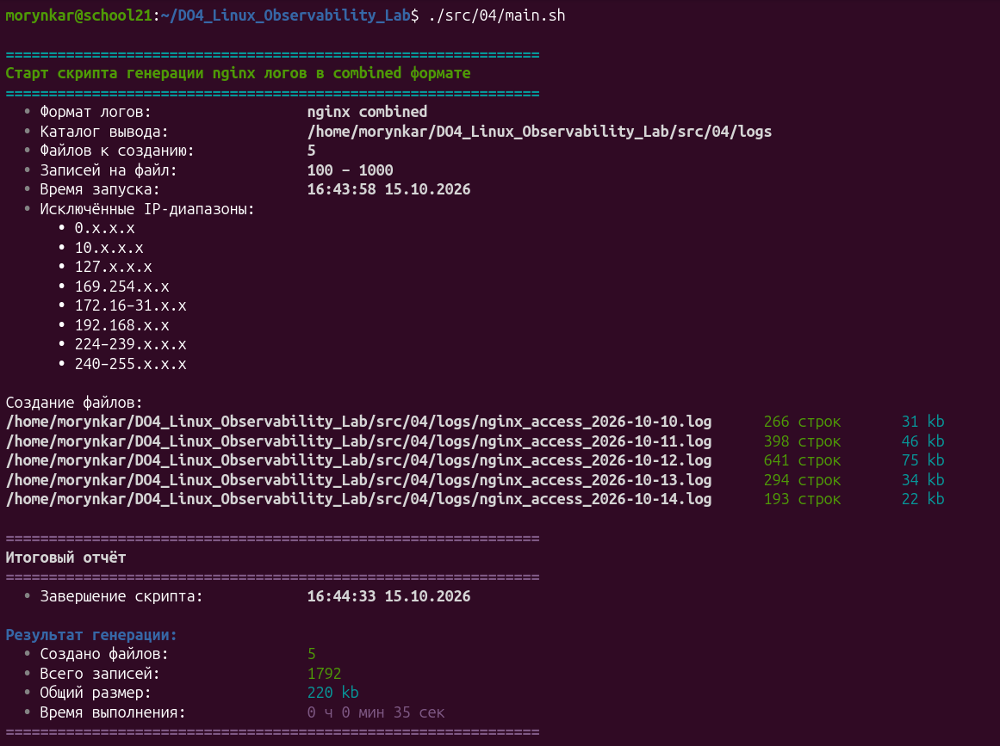

Первые строки файлов показывают структуру Combined Log Format и смену даты между журналами:

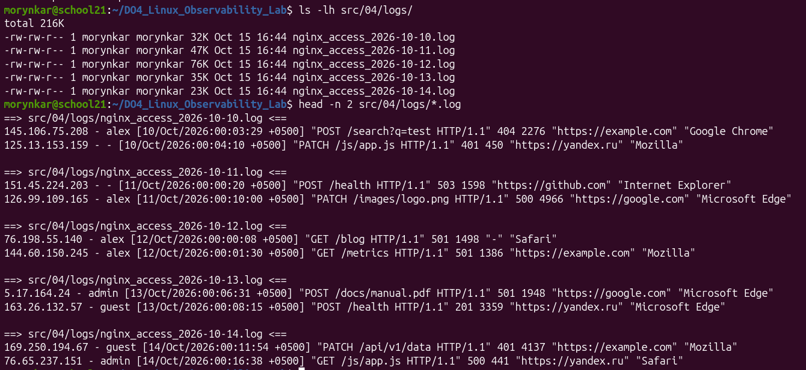

[← Part 3](part1-part3.md#part-3-очистка) · [Следующий этап: Part 5 →](#part-5-анализ-логов)

## Part 5. Анализ логов

На основе `awk` и `sort` реализованы четыре представления: записи по HTTP-коду, уникальные IP, ошибочные запросы и уникальные IP клиентов, получивших ошибки. Анализ выполняется над журналами Part 4.

```bash
./src/05/main.sh 1
./src/05/main.sh 2
./src/05/main.sh 3
./src/05/main.sh 4
```

Исходный код: [`src/05/`](../src/05/).

Результаты четырёх режимов:

| Режим 1: сортировка по HTTP-коду                                           | Режим 2: уникальные IP                                          |
| -------------------------------------------------------------------------- | --------------------------------------------------------------- |
| 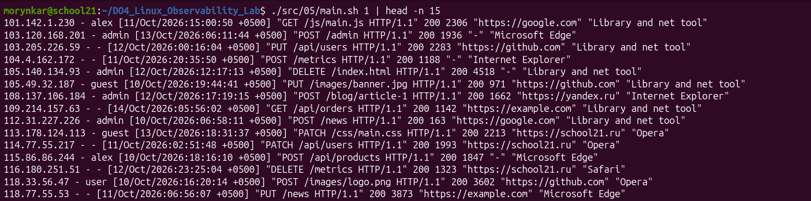 | 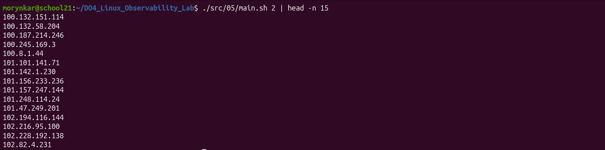    |
| Режим 3: запросы с ошибками                                                | Режим 4: IP клиентов с ошибками                                 |
| 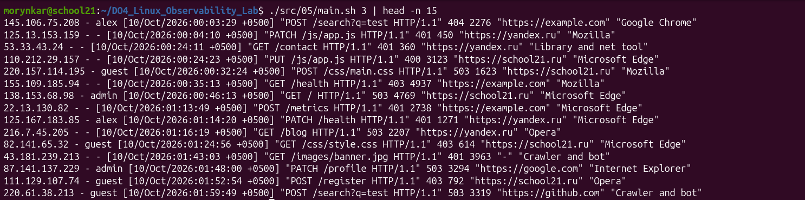             | 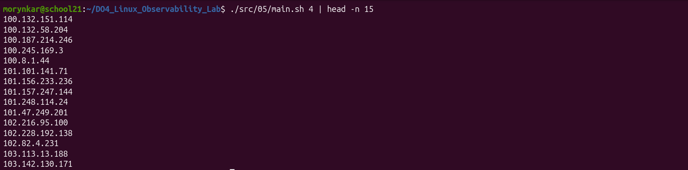 |

[← Part 4](#part-4-генератор-http-логов) · [Следующий этап: Part 6 →](#part-6-анализ-логов-в-goaccess)

## Part 6. Анализ логов в GoAccess

GoAccess читает те же Combined-логи и строит интерактивный терминальный либо HTML-отчёт. В сценарии предусмотрены команды установки, формирования отчёта, запуска локального HTTP-сервера и удаления пакета.

```bash
./src/06/main.sh help
./src/06/main.sh report_terminal
./src/06/main.sh report_html
./src/06/main.sh serve
```

Исходный код: [`src/06/`](../src/06/).

Сценарий предоставляет единое меню для терминального и HTML-представлений:

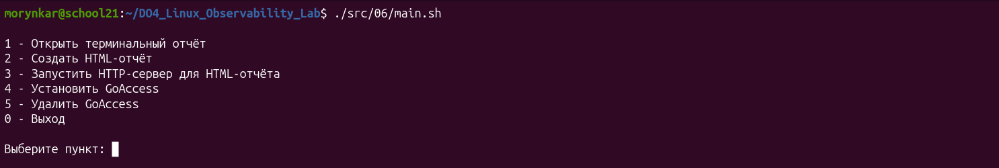

Терминальный отчёт показывает сводные показатели, распределение запросов и отдельные панели для ошибок и HTTP-статусов:

| Общая статистика                                                   | Ошибочные URL                                               | HTTP-статусы                                                             |
| ------------------------------------------------------------------ | ----------------------------------------------------------- | ------------------------------------------------------------------------ |
| 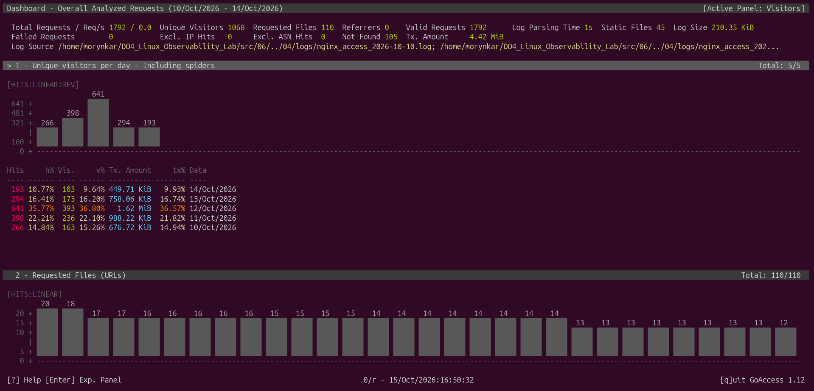 | 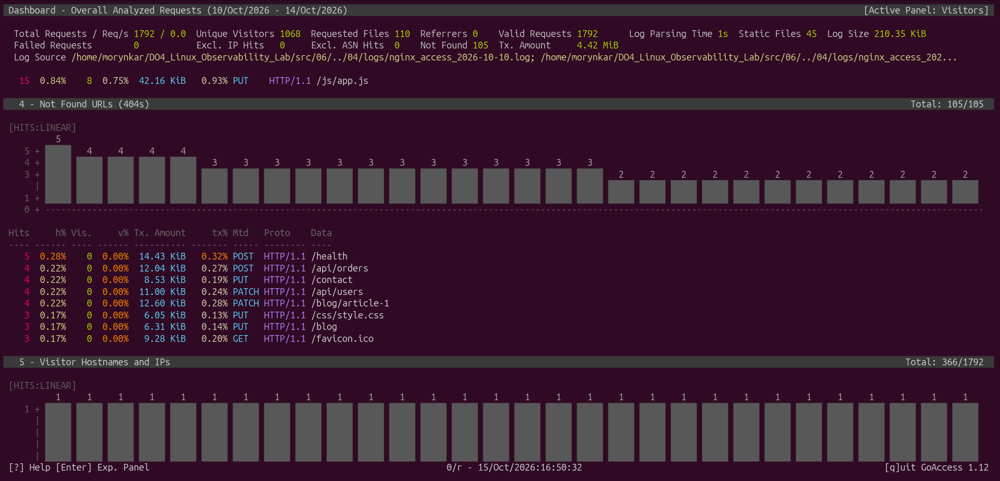 | 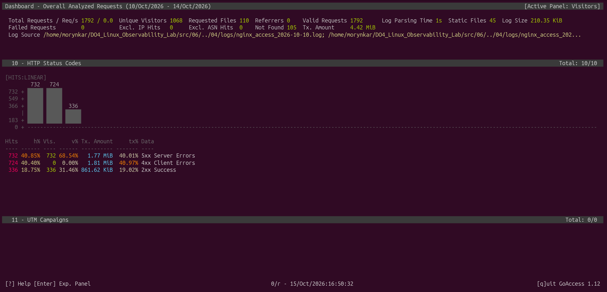 |

HTML-версия содержит ту же статистику в виде интерактивных графиков и таблиц. Контрольный отчёт обработал 1792 запроса, 1068 уникальных посетителей и 110 URL.

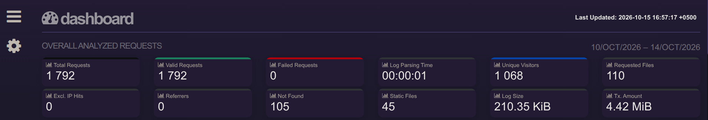

### Графики HTML-отчёта GoAccess

Ниже приведены основные интерактивные представления веб-интерфейса: динамика посетителей, популярные URL, статические ресурсы, ошибки 404, клиентские адреса, операционные системы, браузеры, почасовая активность, источники переходов и группы HTTP-статусов.

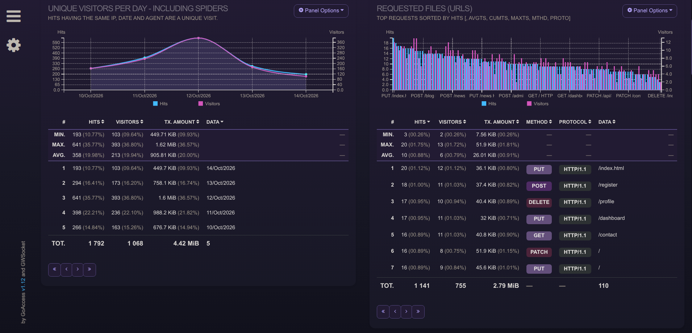

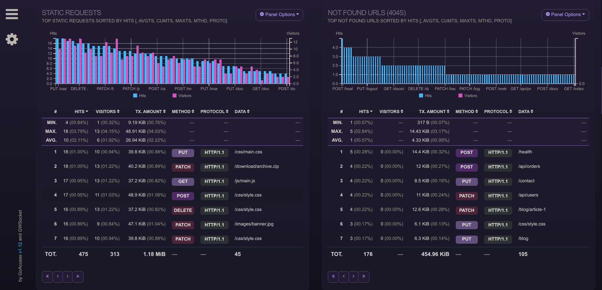

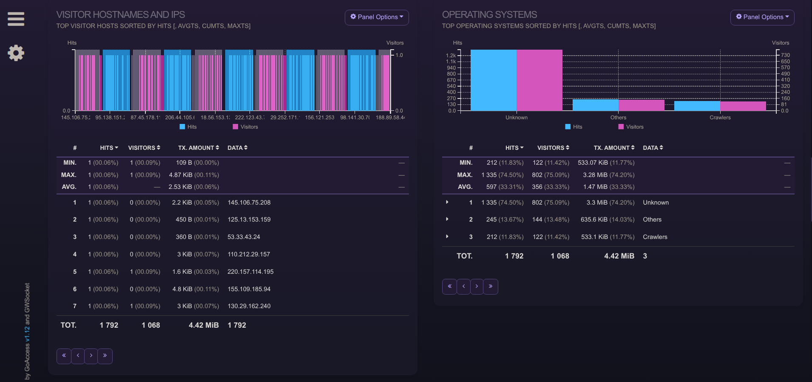

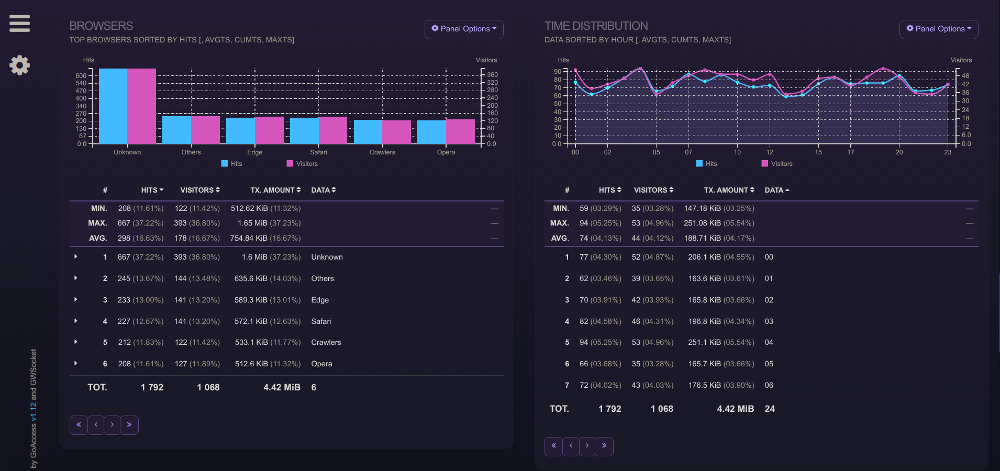

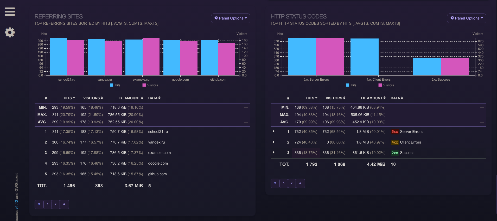

[← Part 5](#part-5-анализ-логов) · [Следующий этап: Part 7 →](part7-prometheus-grafana.md)
