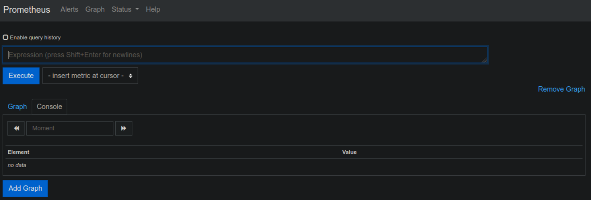
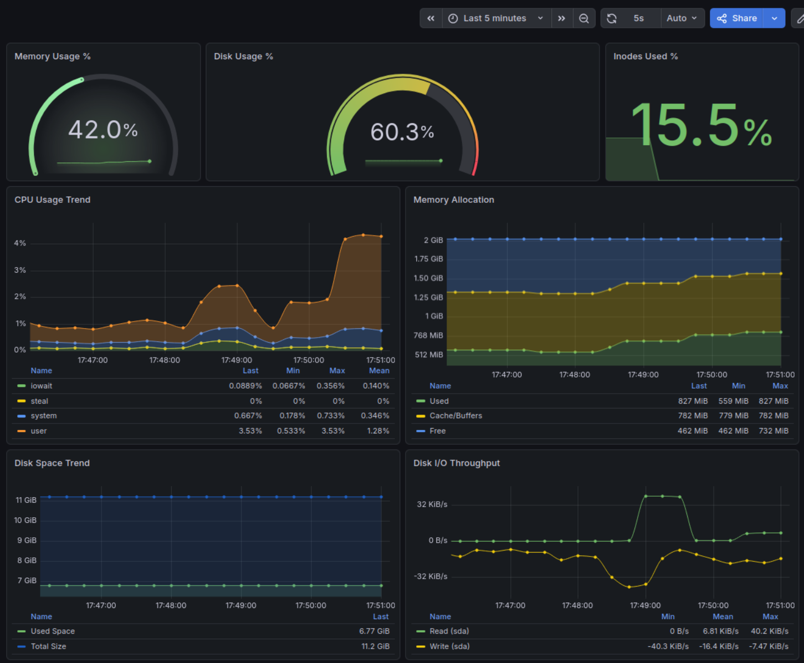
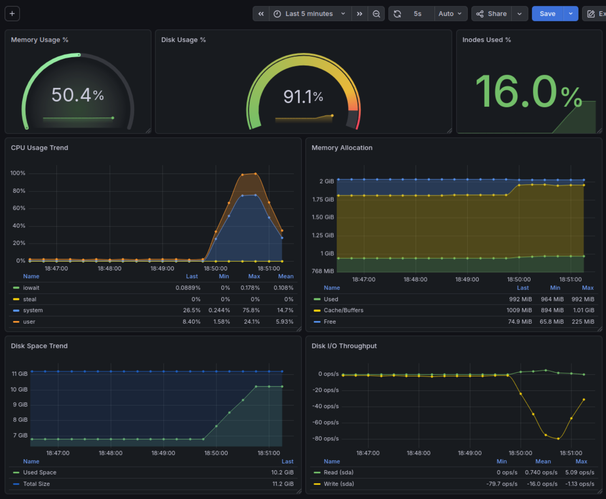
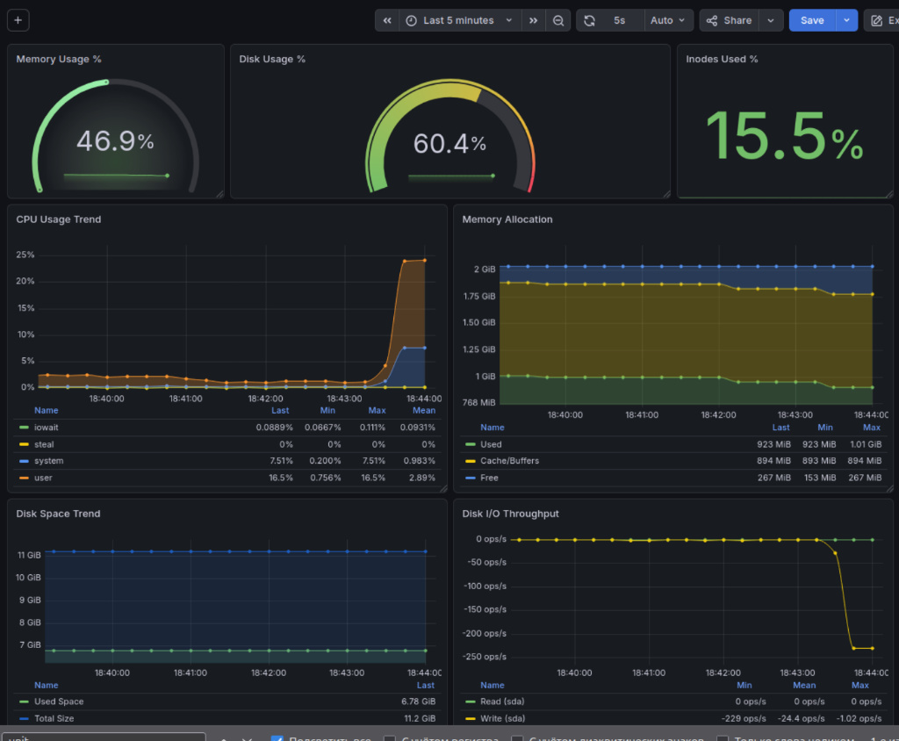

# Part 7. Prometheus и Grafana

[← Parts 4–6](part4-part6.md) · [Оглавление](walkthrough.md) · **Part 7** · [Part 8 →](part8-node-exporter-dashboard.md)

### 1. Установка Prometheus и Grafana

- Установлен Prometheus на виртуальной машине.
- Установлен Prometheus Node Exporter для сбора системных метрик.
- Установлена Grafana на виртуальной машине.

Исходный код автоматизации: [`src/07/`](../src/07/).

*Описание процесса установки и настройки:*
```bash
sudo apt update -y

# Установка и запуск Prometheus и Node Exporter
sudo apt install prometheus prometheus-node-exporter -y
sudo systemctl enable --now prometheus
sudo systemctl enable --now prometheus-node-exporter

# Установка Grafana
# Установка необходимых пакетов
sudo apt-get install -y apt-transport-https wget gnupg

# Импорт ключа GPG:
sudo mkdir -p /etc/apt/keyrings
sudo wget -O /etc/apt/keyrings/grafana.asc https://apt.grafana.com/gpg-full.key
sudo chmod 644 /etc/apt/keyrings/grafana.asc

# Добавить репозиторий для стабильных выпусков
echo "deb [signed-by=/etc/apt/keyrings/grafana.asc] https://apt.grafana.com stable main" | sudo tee /etc/apt/sources.list.d/grafana.list

# Обновление списка доступных пакетов
sudo apt-get update

# Устанавливает последнюю версию OSS:
sudo apt-get install -y grafana

# Запуск Grafana
sudo systemctl enable grafana-server
sudo systemctl start grafana-server

```

#### Доступ к веб-интерфейсам с локальной машины:

- **Prometheus UI:** `http://IP-server:9090`
- **Grafana UI:** `http://IP-server:3000`



Рис. 1. Веб-интерфейс Prometheus, открытый с локальной машины.


Рис. 2. Веб-интерфейс Grafana, открытый с локальной машины.

---

### 2. Настройка дашборда Grafana

- В Grafana добавлен источник данных Prometheus.


Рис. 3. Подключение Prometheus как источника данных Grafana.

- Создан дашборд для мониторинга системы.
- На дашборд добавлены панели для отображения следующих метрик:
    - Нагрузка на ЦПУ (CPU Usage Trend)
    - Доступная оперативная память (Memory Allocation, Memory Usage %)
    - Свободное место на жестком диске (Disk Space Trend, Disk Usage %, Inodes Used %)
    - Количество операций ввода/вывода на жестком диске (Disk I/O Throughput)



Рис. 4. Общий вид пользовательского дашборда Grafana.

Конфигурация дашборда: [`src/07/configs/dashboard-part7.json`](../src/07/configs/dashboard-part7.json).

---

### 3. Тест 1: Запуск bash-скрипта из Части 2 (Засорение файловой системы)
- Запущен скрипт, заполняющий дисковое пространство.
- Зафиксировано изменение метрик в Grafana.

#### Наблюдения за нагрузкой:
* **Свободное место на диске:** *В течение работы скрипта объем занятого пространства (Used Space) стремительно вырос с исходных 6.78 GiB до 10.2 GiB (свободным остался ровно 1 GiB), что наглядно зафиксировал график Disk Space Trend, а круглый индикатор Disk Usage % перешел в критическую зону, показав 91.1%.*
* **Операции чтения/записи (I/OPS):** *График Disk I/O Throughput зафиксировал плотную и стабильную полку генерации файлов: частота операций записи (Write (sda)) держалась на среднем уровне 80 ops/sec (операций в секунду) с кратковременными пиками чтения фоновых процессов.*
* **ЦПУ** - *Зафиксирована пиковая нагрузка на систему. Синий слой работы ядра (system) взлетел до 75.8%, так как операционной системе приходилось непрерывно выделять новые физические блоки на диске под файлы логов, а пользовательская нагрузка (user) составила 24.1%.*
* **Выросло использование ОЗУ** *На графике видно, что в процессе записи Linux агрессивно использовал ОЗУ под дисковый кэш. Желтый слой Cache/Buffers вырос и занял полку в 1.01 GiB, из-за чего объем абсолютно чистой памяти (Free) сократился до критических 74.9 MiB.*
* **Inodes Used %** *Счетчик занятых индексных дескрипторов отреагировал на создание новых файлов и увеличился до 16.0%, зафиксировав появление новых файловых структур в корневой системе.*



Рис. 5. Дашборд Grafana во время и после работы сценария Part 2.

---

### 4. Тест 2: Стресс-тест системы утилитой stress
- Установлена утилита `stress`.
- Выполнена команда:
```bash
sudo apt update -y
sudo apt install stress -y
stress -c 2 -i 1 -m 1 --vm-bytes 32M -t 10s
```

* Зафиксировано изменение метрик в Grafana.

#### Наблюдения за нагрузкой во время стресс-теста:

* ЦПУ: Мгновенный взлет пользовательской нагрузки (user) до 25% и системной (system) до 7.36%.

* ОЗУ: Рост занятой памяти (Used) до 1.10 GiB за счет сжатия свободной (Free) до 71.5 MiB. После теста освободившийся объем корректно перетек в системный кэш (Cache/Buffers).

* Дисковый ввод-вывод: Из-за принудительного вызова sync() скорость записи (Write) кратковременно выросла до пиковых -21 KiB/s на фоне стандартной фоновой активности.

* Объем диска: Линия занятого места осталась неизменной (6.78 GiB), так как тест оперирует временными буферами без создания файлов.

Вывод: Настроенный мониторинг Prometheus + Grafana успешно прошел валидацию, точно и без задержек отобразив комплексную нагрузку на систему ресурсов ВМ.


Рис. 6. Дашборд Grafana, фиксирующий пиковые нагрузки во время работы `stress`.

---

[← Предыдущий этап: Parts 4–6](part4-part6.md) · [Следующий этап: Part 8 →](part8-node-exporter-dashboard.md)
