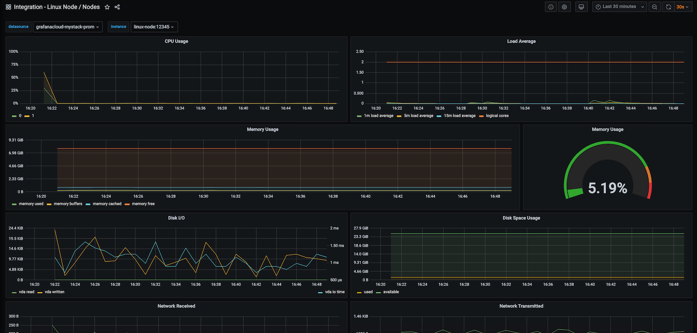
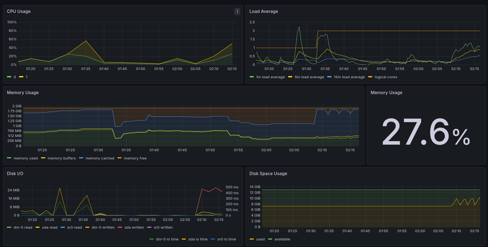
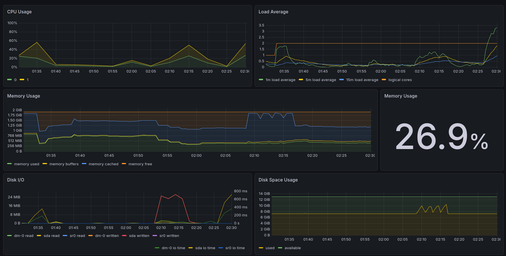
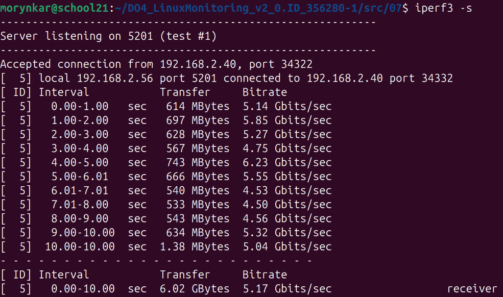
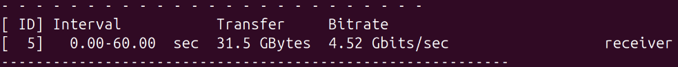
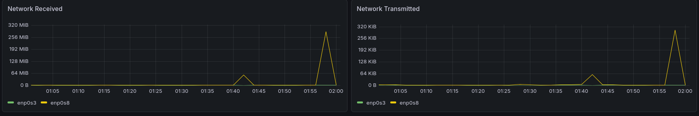

# Part 8. Готовый дашборд

[← README](../README.md) · [Оглавление](walkthrough.md) · [Part 7](part7-prometheus-grafana.md) · **Part 8** · [Part 9 →](part9-custom-exporter.md)

### 1. Установка готового дашборда Node Exporter
- С официального сайта Grafana Labs выбран и импортирован дашборд **Node Exporter Quickstart and Dashboard** https://grafana.com/api/dashboards/13978/revisions/2/download
- Копия дашборда хранится в [`src/08/configs/dashboard-part8.json`](../src/08/configs/dashboard-part8.json).
- Дашборд успешно подключен к источнику данных Prometheus и отображает текущие метрики виртуальной машины.



Рис. 1 общего вида импортированного дашборда Node Exporter Quickstart

---

### 2. Повторение тестов из Части 7
- Запущен bash-скрипт из Части 2 (засорение файловой системы).
- Запущена утилита `stress` с параметрами: `stress -c 2 -i 1 -m 1 --vm-bytes 32M -t 10s`.

#### Анализ отображения тестов на новом дашборде:
* **Поведение графиков при четырёхкратном заполнении диска:**

    * **Объем диска (Disk Space Usage):** Вместо одной ступеньки график выдал четыре четких зубца (рост с 7.5 до 10 GiB и быстрый сброс). Это идеально зафиксировало каждый из четырех циклов генерации и последующей очистки.

    * **Дисковая активность (Disk I/O):** В моменты тестов скорость записи (sda written) стабильно уходила в полку до 24 MiB/s, а время ожидания диска (io time) заметно выросло из-за плотного потока данных.

    * **ЦПУ (CPU Usage):** График наглядно отобразил распределение задач по двум ядрам ВМ: утилизация ядра 1 поднялась до 50%, а ядра 0 — до 25%.

    * **Средняя нагрузка (Load Average):** Вслед за тестами метрика 1m load average поползла вверх и достигла отметки 1.2. На фоне лимита в 2.0 (logical cores) это указывает на то, что двухъядерная система была загружена чуть более чем наполовину.

    * **Оперативная память (Memory Usage):** Во время записи ОЗУ активно уходила под дисковый кэш — слой memory cached сделал уверенную ступеньку вверх, защищая процессор от задержек диска. Общий индикатор зафиксировал среднюю занятость памяти на уровне 27.6%.
  
* **Поведение графиков при стресс-тесте:** 
    * **ЦПУ (CPU Usage):** Зафиксирован синхронный взлет утилизации ядер: нагрузка на ядро 1 поднялась до 55%, на ядро 0 — до 25%.

    * **Средняя нагрузка (Load Average):** Метрика 1m load average ушла вертикально вверх и достигла пиковых 3.3 при лимите системы в 2.0 (logical cores), что указывает на жесткую перегрузку процессора и образование очереди задач.

    * **Дисковая активность (Disk I/O):** Параметр -i 1 спровоцировал критический рост задержек. Время ожидания диска (sda io time) взлетело до пиковых 750 ms из-за непрерывных вызовов sync().

    * **Оперативная память (Memory Usage):** Слои памяти кратковременно перераспределились под нужды виртуальных буферов теста, удержав общую занятость ОЗУ на отметке 26.9%.

    * **Объем диска (Disk Space Usage):** Линия занятого места осталась идеально плоской на уровне 7.5 GiB, подтверждая, что утилита stress работает без создания постоянных файлов в ФС.

* *Сравнение с кастомным дашбордом: Готовый дашборд Node Exporter Quickstart удобнее ручного. Он предоставляет более глубокую системную аналитику «из коробки»: содержит важнейшие метрики очередей процессов (Load Average), задержки дисковых операций (io time) в миллисекундах и наглядно разделяет абстракции накопителей (sda / dm-0), что критически важно для комплексной диагностики ВМ.*



Рис. 2 дашборда Node Exporter во время работы bash-скрипта



Рис. 3 дашборда Node Exporter во время работы утилиты stress

---

### 3. Настройка сетевого теста с iperf3
- Запущена вторая виртуальная машина (ВМ-2) в одной сети с первой (ВМ-1).
- На обеих машинах установлена утилита `iperf3`.
- На одной из машин `iperf3` запущен в режиме сервера.
- На второй машине `iperf3` запущен в режиме клиента для генерации сетевой нагрузки.

*Команда запуска на сервере:*
```bash
sudo apt install iperf3 -y
iperf3 -s

```

*Команда запуска на клиенте:*

```bash
sudo apt install iperf3 -y
iperf3 -c <IP_адрес_сервера> -t 60

```




Рис. 4 вывода терминала с результатами выполнения iperf3 на сервере/клиенте.

---

### 4. Нагрузка сетевого интерфейса в Grafana

* Зафиксирована сетевая активность на дашборде во время теста `iperf3`.

#### Наблюдения за сетевой нагрузкой:

* **Сетевой интерфейс:** *enp0s8*
* **Показатели скорости:** *287 MiB*



---

[← Предыдущий этап: Part 7](part7-prometheus-grafana.md) · [Следующий этап: Part 9 →](part9-custom-exporter.md)

Рис. 5 графиков сетевого интерфейса (Network Traffic) на дашборде Node Exporter во время теста iperf3.
