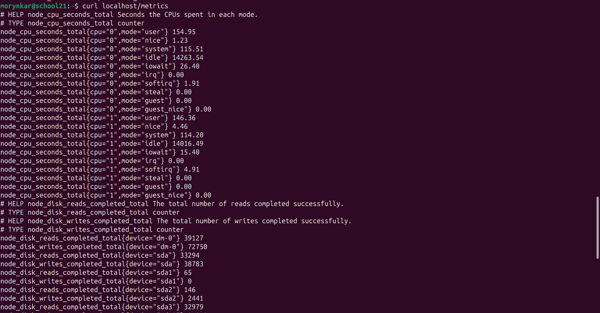
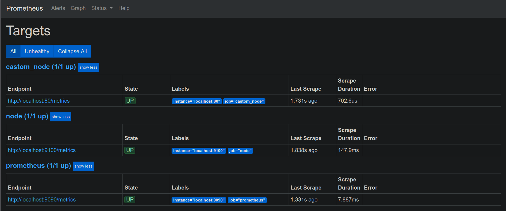
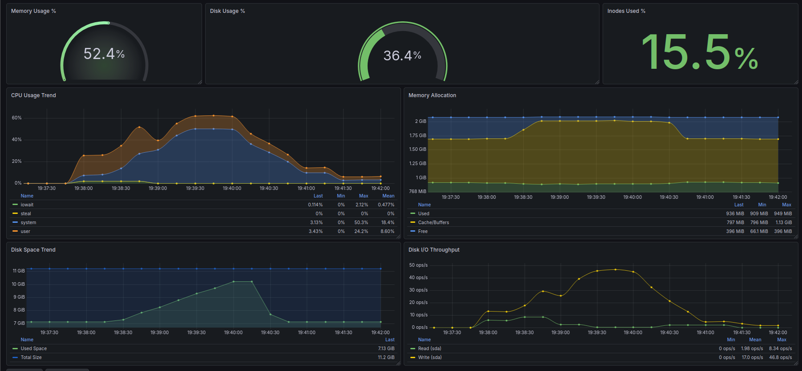
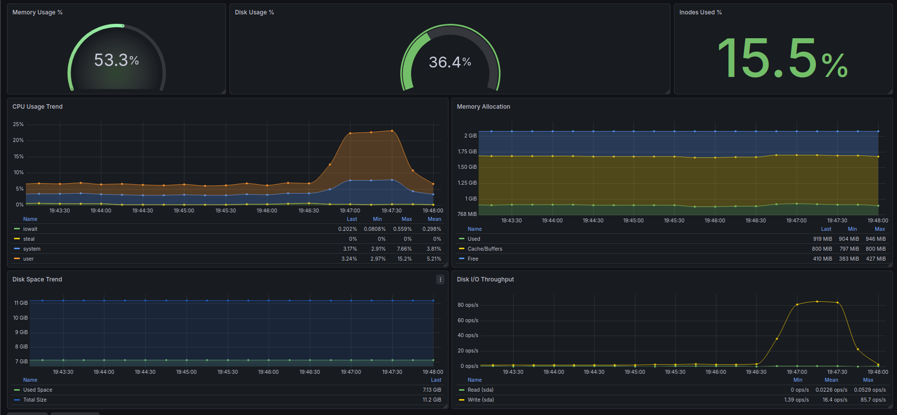

# Part 9. Дополнительно. Свой node_exporter

[← README](../README.md) · [Оглавление](walkthrough.md) · [Part 7](part7-prometheus-grafana.md) · [Part 8](part8-node-exporter-dashboard.md) · **Part 9**

### 1. Реализация кастомного экспортера
- Написан bash-скрипт для сбора базовых метрик системы.
- Реализован сбор метрик:
    - Нагрузка/использование ЦПУ (CPU)
    - Оперативная память (использовано/доступно RAM)
    - Жесткий диск (объем/свободное место)
- Настроен экспорт данных в текстовый файл/страницу в формате Prometheus (`/var/www/html/metrics` формат: `metric_name value`).
- Настроено обновление метрик (через цикл в скрипте) с интервалом не чаще, чем раз в 3 секунды.

```bash
node_cpu_seconds_total() {
    local i j cpu field value hz
    local cpu_el=(user nice system idle iowait irq softirq steal guest guest_nice)

    echo '# HELP node_cpu_seconds_total Seconds the CPUs spent in each mode.'
    echo '# TYPE node_cpu_seconds_total counter'

    hz=$(getconf CLK_TCK)

    for (( i=0; i<$(nproc); i++ )); do
        cpu="cpu${i}"

        for (( j=0; j<${#cpu_el[@]}; j++ )); do
            field=$(( j + 2 ))

            value=$(awk -v cpu="$cpu" -v f="$field" -v hz="$hz" '
                $1 == cpu { printf "%.2f", $f / hz }
            ' /proc/stat)

            printf 'node_cpu_seconds_total{cpu="%s",mode="%s"} %s\n' \
                "$i" "${cpu_el[j]}" "$value"
        done
    done
}

node_disk_stats_total() {
    local dev reads_completed writes_completed
    local devs
    echo '# HELP node_disk_reads_completed_total The total number of reads completed successfully.'
    echo '# TYPE node_disk_reads_completed_total counter'
    echo '# HELP node_disk_writes_completed_total The total number of writes completed successfully.'
    echo '# TYPE node_disk_writes_completed_total counter'

    mapfile -t devs < <(
        awk '$3 !~ /^(loop|ram|sr|fd)/ {print $3}' /proc/diskstats | sort -u
    )

    for dev in "${devs[@]}"; do
        read -r reads_completed writes_completed < <(
            awk -v d="$dev" '$3 == d {print $4, $8}' /proc/diskstats
        )

        printf 'node_disk_reads_completed_total{device="%s"} %s\n' \
            "$dev" "$reads_completed"

        printf 'node_disk_writes_completed_total{device="%s"} %s\n' \
            "$dev" "$writes_completed"
    done
    echo
}

node_filesystem() {
    local line device size_bytes avail_bytes mountpoint fstype
    local lines

    echo '# HELP node_filesystem_size_bytes Filesystem size in bytes.'
    echo '# TYPE node_filesystem_size_bytes gauge'
    echo '# HELP node_filesystem_avail_bytes Filesystem space available to non-root users in bytes.'
    echo '# TYPE node_filesystem_avail_bytes gauge'


    mapfile -t lines < <(
        df -B1 --output=source,fstype,size,avail,target |
        tail -n +2 |
        awk '$1 !~ /^(tmpfs|devtmpfs|proc|sysfs|cgroup|overlay|squashfs|snap|udev)$/ &&
             $5 !~ /^(\/run|\/sys|\/proc|\/dev)$/ {
                 print $1, $2, $3, $4, $5
             }'
    )

    for line in "${lines[@]}"; do
        read -r device fstype size_bytes avail_bytes mountpoint <<< "$line"

        printf 'node_filesystem_size_bytes{device="%s",fstype="%s",mountpoint="%s"} %s\n' \
            "$device" "$fstype" "$mountpoint" "$size_bytes"

        printf 'node_filesystem_avail_bytes{device="%s",fstype="%s",mountpoint="%s"} %s\n' \
            "$device" "$fstype" "$mountpoint" "$avail_bytes"
    done
    echo
}

node_filesystem_inode() {
    echo '# HELP node_filesystem_files Filesystem total file nodes.'
    echo '# TYPE node_filesystem_files gauge'
    echo '# HELP node_filesystem_files_free Filesystem total free file nodes.'
    echo '# TYPE node_filesystem_files_free gauge'
    
    df -iT | awk '
    NR > 1 &&
    $1 !~ /^(tmpfs|devtmpfs|proc|sysfs|cgroup|overlay|squashfs|snap|udev)$/ &&
    $7 !~ /^(\/run|\/sys|\/proc|\/dev)$/ {
        printf "node_filesystem_files{device=\"%s\",fstype=\"%s\",mountpoint=\"%s\"} %s\n", $1, $2, $7, $3
        printf "node_filesystem_files_free{device=\"%s\",fstype=\"%s\",mountpoint=\"%s\"} %s\n", $1, $2, $7, $5
    }'
    echo
}

node_memory() {
    local total available cached free_mem

    read -r total free_mem cached available < <(
        free -b | awk 'NR==2 {print $2, $4, $6, $7}'
    )

    echo '# HELP node_memory_MemTotal_bytes Memory information field MemTotal_bytes.'
    echo '# TYPE node_memory_MemTotal_bytes gauge'
    echo "node_memory_MemTotal_bytes $total"

    echo '# HELP node_memory_MemAvailable_bytes Memory information field MemAvailable_bytes.'
    echo '# TYPE node_memory_MemAvailable_bytes gauge'
    echo "node_memory_MemAvailable_bytes $available"

    echo '# HELP node_memory_Cached_bytes Memory information field Cached_bytes.'
    echo '# TYPE node_memory_Cached_bytes gauge'
    echo "node_memory_Cached_bytes $cached"

    echo '# HELP node_memory_MemFree_bytes Memory information field MemFree_bytes.'
    echo '# TYPE node_memory_MemFree_bytes gauge'
    echo "node_memory_MemFree_bytes $free_mem"

    echo
}

generate_metrics() {
    while true; do    
        {
        # информация о CPU
        node_cpu_seconds_total
        
        # информация о диске
        node_disk_stats_total

        # информация о файловой системе
        node_filesystem
        node_filesystem_inode

        # информация о памяти
        node_memory
        } > "$TMP_FILE"

        mv "$TMP_FILE" "$METRICS_FILE"
        sleep 3
    done
}

```

---

### 2. Настройка Nginx и Prometheus

* Конфигурационный файл **Nginx** настроен для отдачи сформированной страницы с метриками (по пути `/metrics`).
* Проверен доступ к странице метрик через `curl http://IP_виртуальной_машины:80/metrics` с локальной машины.
* Конфигурационный файл **Prometheus** (`prometheus.yml`) изменен: добавлен новый `job_name` для сбора метрик с созданной страницы Nginx.

* В веб-интерфейсе Prometheus новый таргет отображается в статусе `UP`.

*Фрагмент конфигурации Nginx (server block):*

```nginx
server {
	listen 80 default_server;
	listen [::]:80 default_server;

	root /var/www/html;

	index index.html index.htm index.nginx-debian.html;

	server_name _;

	location / {
		try_files $uri $uri/ =404;
	}
}

```

*Фрагмент конфигурации prometheus.yml:*

```yaml
- job_name: custom_node
    scrape_interval: 3s
    scrape_timeout: 3s
    
    static_configs:
       - targets: ['localhost:80']

```


Рис. 1 метрики в формате Prometheus, отдаваемые Nginx



Рис. 2 Вкладка Targets в Prometheus, где виден кастомный экспортер в статусе UP

---

### 3. Повторение тестов из Части 7

* Запущен bash-скрипт из Части 2 (засорение файловой системы).
* Запущена утилита `stress` с параметрами: `stress -c 2 -i 1 -m 1 --vm-bytes 32M -t 10s`.
* Проверен сбор измененных метрик в Prometheus.

#### Результаты и графики:

* **Засорение диска:** *Результат совпадает с дашбордом из part 7.*
* **Стресс-тест:** *Результат совпадает с дашбордом из part 7.*



Рис. 3 Графики для кастомных метрик диска во время теста из Части 2



---

[← Предыдущий этап: Part 8](part8-node-exporter-dashboard.md) · [Завершить и вернуться в README →](../README.md)

Рис. 4 Графики для кастомных метрик CPU/RAM во время работы утилиты stress
